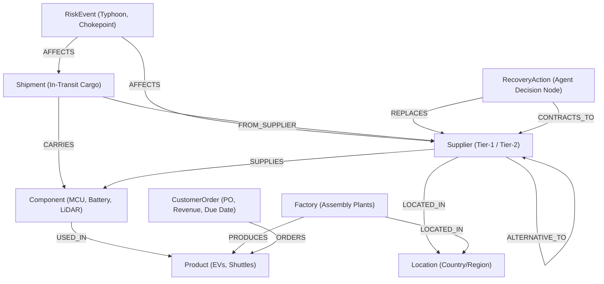

# 🛡️ SupplyShield AI — Graph-Powered Supply Chain Disruption & Recovery Agent

> **FalkorDB Hackathon Submission**  
> **Track:** Track 01 — *Agents That Act on Connected Data*  
> **Primary Graph Database:** [FalkorDB](https://www.falkordb.com/) (In-Memory Graph Engine)

---

## 📌 Executive Summary

When a Tier-1 supplier or manufacturing facility suffers a sudden disruption (e.g., natural disasters, factory shutdowns, geopolitical choke points), global enterprises face a severe ripple effect. Traditional relational databases require 5+ complex SQL `JOIN` operations across disparate tables to discover which parts, vehicle assembly lines, and customer orders are at risk.

**SupplyShield AI** solves this problem by using **FalkorDB** as its primary relationship and reasoning engine. The autonomous agent traverses the multi-tier supply chain graph in **under 5 milliseconds**, quantifies financial exposure, evaluates alternative suppliers using transparent deterministic scoring, executes recovery actions, and persists decisions into FalkorDB graph memory across sessions.

---

## 🎯 Alignment with Hackathon Track 01 ("Agents That Act on Connected Data")

| Track Requirement | SupplyShield AI Implementation |
| :--- | :--- |
| **Multi-hop reasoning** | Multi-tier Cypher traversals: `(:Supplier)-[:SUPPLIES]->(:Component)-[:USED_IN]->(:Product)<-[:ORDERS]-(:CustomerOrder)`. |
| **Graph queries as agent tools** | Cypher queries wrapped as callable agent tools via FastAPI and Model Context Protocol (MCP). |
| **Tool selection through MCP** | Standardized MCP Server (`backend/app/mcp_server.py`) exposing tools to LLMs and agent orchestrators. |
| **Actions based on what graph shows** | When the agent selects the optimal alternative, it commits a `(:RecoveryAction)` node directly into FalkorDB. |
| **Remember across sessions** | Past incident decisions, justifications, and scores are queried from FalkorDB graph memory. |
| **Explainable results** | Traceable evidence paths and a mathematical breakdown of why suppliers are accepted or disqualified. |

---

## 🏗️ Graph Data Model & Schema

The graph model represents a multi-echelon automotive & electronics supply chain:



### Node Labels (44 Seeded Entities)
- **Supplier (6)**: Disrupted primary suppliers, verified alternatives, and disqualified candidates.
- **Component (7)**: Critical MCUs, battery management ASICs, LiDAR sensors, transceivers.
- **Factory (3)**: Assembly facilities in Munich, Austin, and Yokohama.
- **Product (5)**: CyberDrive EV Sedan, AeroTruck Commercial EV, RoboTaxi Shuttle, Energy Wall.
- **CustomerOrder (9)**: High-priority fleet delivery contracts representing over $62M in revenue.
- **Shipment (4)**: Air and maritime transit cargo batches.
- **RiskEvent (2)**: Super Typhoon Gaemi (Critical) and Canal Shipping Congestion (Medium).
- **Location (8)**: Regional technology and manufacturing hubs.

---

## 🔍 Core Graph Queries & Traversal Logic

### 1. Downstream Impact Traversal
Traces the full blast radius from the disrupted supplier down to customer delivery commitments:
```cypher
MATCH path = (s:Supplier {id: $supplier_id})-[:SUPPLIES]->(c:Component)-[:USED_IN]->(p:Product)<-[:ORDERS]-(o:CustomerOrder)
RETURN s.name AS supplier, c.name AS component, p.name AS product, 
       o.order_number AS order_num, o.customer_name AS customer, o.revenue AS revenue
ORDER BY o.days_until_due ASC
```

### 2. Verified Alternative Supplier Discovery
Discovers alternative suppliers for the disrupted component while excluding the down supplier:
```cypher
MATCH (alt:Supplier)
WHERE alt.id <> $disrupted_id
OPTIONAL MATCH (alt)-[alt_rel:ALTERNATIVE_TO]->(s_orig:Supplier {id: $disrupted_id})
OPTIONAL MATCH (alt)-[sup_rel:SUPPLIES]->(c_alt:Component)
WHERE c_alt.id = $comp_id OR c_alt.id = alt_rel.component_id
RETURN DISTINCT alt.id, alt.name, alt.capacity, alt.lead_time_days, 
                alt.risk_score, alt_rel.compatibility_score, alt_rel.verified
```

### 3. Action Execution & Graph Memory
Writes the agent's decision into FalkorDB so state is preserved across sessions:
```cypher
MATCH (disrupted:Supplier {id: $disrupted_id})
MATCH (alt:Supplier {id: $alt_id})
CREATE (act:RecoveryAction {
    id: $action_id,
    action_type: 'REROUTE_SUPPLY',
    status: 'EXECUTED',
    component_id: $comp_id,
    justification: $justification,
    decision_score: $score,
    agent_name: 'SupplyShield AI Agent',
    timestamp: $timestamp
})
CREATE (act)-[:REPLACES]->(disrupted)
CREATE (act)-[:CONTRACTS_TO]->(alt)
```

---

## ⚖️ Deterministic Scoring Algorithm

SupplyShield evaluates candidates using transparent mathematical scoring and strict qualification constraints (no hallucinated inventory or fake specs):

### Formula:
$$\text{Score} = (W_{\text{compat}} \times \text{Compatibility}) + (W_{\text{cap}} \times \text{NormCapacity}) + (W_{\text{lead}} \times \text{LeadFactor}) + (W_{\text{risk}} \times (1 - \text{Risk}))$$

- **Component Compatibility (40%)**: Verified pin-for-pin and firmware compatibility score.
- **Manufacturing Capacity (30%)**: Normalized available monthly units.
- **Lead Time (20%)**: Turnaround delivery speed factor.
- **Supplier Risk (10%)**: Inverted historical risk rating.

### Hard Constraints (Instant Disqualification):
- **Compatibility < 0.80**: Disqualified (non-automotive grade or incompatible pinout).
- **Available Capacity < 2,000 units**: Disqualified (cannot fulfill minimum production batch).

---

## 🚀 Quickstart Guide (Local Setup)

### Prerequisites
- Docker & Docker Compose
- Python 3.11+ (or `uv`)

### Step 1: Start FalkorDB and FalkorDB Browser
```powershell
docker compose up -d
```
- **FalkorDB Graph Engine**: Running on `127.0.0.1:6379`
- **FalkorDB Visual Browser**: Accessible at `http://localhost:3000`

### Step 2: Seed the Knowledge Graph
```powershell
cd backend
uv run python -m app.graph.seed
```

### Step 3: Run the Autonomous Disruption Agent CLI
```powershell
uv run python agent_cli.py
```

### Step 4: Run the Automated Test Suite (10/10 Tests)
```powershell
uv run pytest
```

### Step 5: Start the FastAPI Backend (Interactive Docs)
```powershell
uv run uvicorn app.main:app --reload
```
Open **[http://127.0.0.1:8000/docs](http://127.0.0.1:8000/docs)** to interact with all API endpoints and schemas via Swagger UI.

---

## 🌐 Model Context Protocol (MCP) Server

SupplyShield AI includes an MCP server conforming to standard JSON-RPC over `stdio`:
```powershell
cd backend
uv run python -m app.mcp_server
```

**Exposed MCP Tools:**
1. `get_supply_chain_overview`: High-level graph topology counts.
2. `analyze_disruption`: Multi-hop downstream blast radius calculator.
3. `find_compatible_alternatives`: Deterministic candidate evaluator.
4. `recommend_recovery_plan`: Holistic advisory recovery recommendation.
5. `execute_recovery_action`: Graph action committer.
6. `get_agent_decision_history`: Cross-session graph memory retriever.

---

## 📊 Live Verification via FalkorDB Browser

Open **[http://localhost:3000](http://localhost:3000)** in your browser:
1. Connect to host: `falkordb`, port: `6379`.
2. Select graph: `supplyshield`.
3. Run:
```cypher
MATCH (n)-[r]->(m) RETURN n, r, m
```
*(Displays the interactive 44-node supply-chain graph with visual zoom, pan, and node inspector).*

---

## 🤖 AI Assistant Disclosure
In accordance with hackathon rules, an AI coding assistant (Google Antigravity / Gemini) was used during development for scaffolding boilerplate, syntax verification against FalkorDB documentation, and formatting documentation. All graph data modeling, Cypher queries, deterministic scoring algorithms, and test assertions were reviewed and validated against a live FalkorDB instance.
